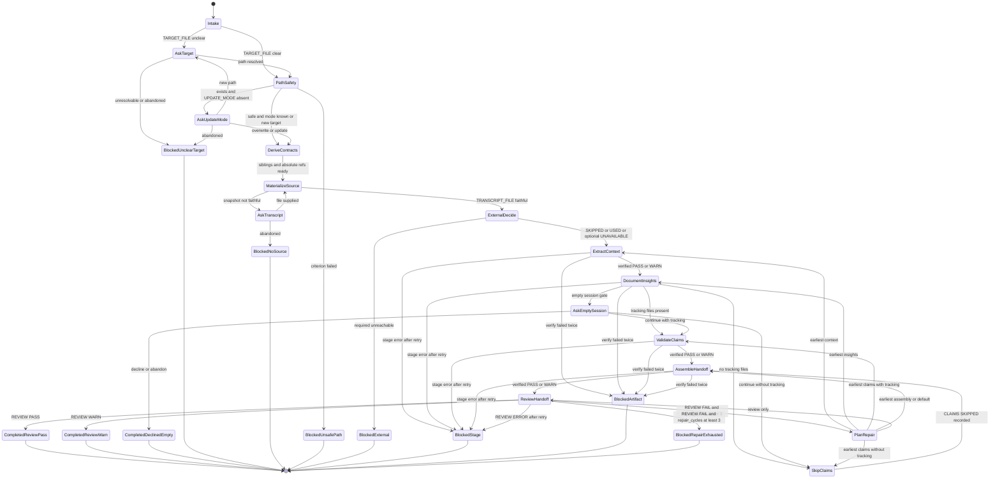

# Generate Handoff Document Flow Diagram

Canonical execution model: finite state machine. Guards, variables, and terminals are tabulated in [`state-machine.md`](./state-machine.md); this diagram is illustrative and defers to that table on any mismatch.

## Terminal outcomes

| State                    | Outcome in prose                                               |
| ------------------------ | ---------------------------------------------------------- |
| `CompletedReviewPass`    | `The handoff passed review.`                                   |
| `CompletedReviewWarn`    | `The handoff passed review with warnings.`                     |
| `CompletedDeclinedEmpty` | `No handoff was written because the empty-session handoff was declined.`              |
| `BlockedUnclearTarget`   | `A clear target path is needed before writing the handoff.`                             |
| `BlockedNoSource`        | `A usable source transcript is needed before writing the handoff.`                     |
| `BlockedUnsafePath`      | `The handoff was not written because the path is unsafe or inaccessible.` |
| `BlockedExternal`        | `The handoff cannot proceed because a required external dependency is unavailable.`        |
| `BlockedStage`           | `The handoff cannot proceed because a stage failed or was unexpectedly skipped.`     |
| `BlockedArtifact`        | `The handoff cannot proceed because an artifact failed its contract.`                     |
| `BlockedRepairExhausted` | `The handoff still fails review after the repair limit.`                          |
