# PR creation workflow

Illustrative only. [State-machine.md](./state-machine.md) governs every route,
first-match guard, counter, and terminal. This view abbreviates common guards;
it does not create exceptions to them. Every specialist return passes the
consumer checker before any routed field is read. Missing/malformed output or
checker exit 1/2 goes to `TerminalError`, without repair or mutating retry.

All human gates share abort, unavailable-wait, and one-re-ask rules. Recovery
ledgers have cap 3; authoritative URL lookup has cap 1 per uncertain decision.
Initialize counters before any input gate. Counted revisits consume their named
ledger before taking the edge; at cap they go to `TerminalBlocked` with reason
`ESCALATED`. An unclear/unusable answer with re-ask count below 1 increments it
and re-asks once; another at count 1, or unavailable wait, is blocked with reason
`AWAITING_USER`. Success is not blocked by an exhausted non-PASS ledger.
Submission-internal lookup/readback limits are not redispatch edges here.

```mermaid
stateDiagram-v2
  [*] --> ResolveMode
  ResolveMode --> NormalizeInputs: root and adapter resolved
  ResolveMode --> TerminalBlocked: required capability or root missing
  NormalizeInputs --> GateInput: invalid requested state
  NormalizeInputs --> InitRun: inputs usable
  GateInput --> NormalizeInputs: valid state and input ledger available
  GateInput --> TerminalBlocked: abort or unusable answer at cap
  InitRun --> InspectRepo: owned external run initialized
  InitRun --> TerminalBlocked: prerequisite or tool unavailable
  InitRun --> TerminalError: unrecoverable initialization failure

  InspectRepo --> ResolveRepoFacts: checked PASS
  InspectRepo --> TerminalBlocked: BLOCKED or TOOLS_MISSING
  InspectRepo --> TerminalError: ERROR or invalid reply
  ResolveRepoFacts --> GateTopology: topology ambiguous
  ResolveRepoFacts --> GateTargetBranch: topology resolved and target missing
  ResolveRepoFacts --> AdaptPlatform: path or capability unresolved
  ResolveRepoFacts --> GateStateFallback: draft unsupported and ready path checked
  ResolveRepoFacts --> TerminalBlocked: ready unsupported
  ResolveRepoFacts --> RunPreflight: checked requested state supported
  GateTopology --> InspectRepo: chosen remotes and topology ledger available
  GateTopology --> TerminalBlocked: abort or wait or cap
  GateTargetBranch --> InspectRepo: explicit target and target ledger available
  GateTargetBranch --> TerminalBlocked: abort or wait or cap
  AdaptPlatform --> InspectRepo: evidence obtained and platform ledger available
  AdaptPlatform --> GatePlatformTooling: bounded lookup still uncertain
  AdaptPlatform --> TerminalBlocked: missing tools or cap
  GatePlatformTooling --> InspectRepo: usable choice and platform ledger available
  GatePlatformTooling --> TerminalBlocked: abort or wait or cap
  GateStateFallback --> RunPreflight: APPROVED checked ready path
  GateStateFallback --> InspectRepo: REVISE and platform ledger available
  GateStateFallback --> TerminalBlocked: no safe path or abort or wait or cap

  RunPreflight --> AnalyzeDiff: checked PASS
  RunPreflight --> GatePush: PUSH_REQUIRED and push ledger available
  RunPreflight --> GatePushRejected: PUSH_REJECTED and push ledger available
  RunPreflight --> TerminalBlocked: PR_EXISTS or prerequisite or TOOLS_MISSING or cap
  RunPreflight --> TerminalError: ERROR or invalid reply
  GatePush --> RunPreflight: APPROVED exact SHA refspec and push ledger available
  GatePush --> InspectRepo: REVISE topology and push ledger available
  GatePush --> RunPreflight: REVISE publication and push ledger available
  GatePush --> TerminalBlocked: abort or wait or cap
  GatePushRejected --> RunPreflight: manual resolution confirmed and push ledger available
  GatePushRejected --> TerminalBlocked: abort or wait or cap

  AnalyzeDiff --> ResolveSources: checked PASS
  AnalyzeDiff --> GateScope: LARGE_PR_CONFIRMATION_REQUIRED and scope ledger available
  AnalyzeDiff --> TerminalBlocked: EMPTY_DIFF or TOOLS_MISSING or cap
  AnalyzeDiff --> TerminalError: ERROR or invalid reply
  GateScope --> AnalyzeDiff: APPROVED current pins and scope ledger available
  GateScope --> RunPreflight: REVISE external scope and scope ledger available
  GateScope --> TerminalBlocked: abort or wait or cap
  ResolveSources --> DraftPr: source contract resolved
  ResolveSources --> GateDraftChoice: selection uncertain and choice ledger available
  ResolveSources --> TerminalBlocked: missing capability or choice cap
  ResolveSources --> TerminalError: unrecoverable source failure
  DraftPr --> SuggestMetadata: checked PASS
  DraftPr --> GateDraftChoice: NEEDS_CHOICE and choice ledger available
  DraftPr --> TerminalBlocked: TOOLS_MISSING or choice cap
  DraftPr --> TerminalError: ERROR or invalid reply
  GateDraftChoice --> ResolveSources: source choice and choice ledger available
  GateDraftChoice --> DraftPr: type or scope choice and choice ledger available
  GateDraftChoice --> TerminalBlocked: abort or wait or cap

  SuggestMetadata --> ShowPreview: checked PASS
  SuggestMetadata --> GateReviewer: NEEDS_REVIEWER and reviewer ledger available
  SuggestMetadata --> GateLabels: INVALID_LABELS and label ledger available
  SuggestMetadata --> TerminalBlocked: AUTH or BLOCKED or TOOLS_MISSING or cap
  SuggestMetadata --> TerminalError: ERROR or invalid reply
  GateReviewer --> SuggestMetadata: named reviewers or none and reviewer ledger available
  GateReviewer --> TerminalBlocked: abort or wait or cap
  GateLabels --> SuggestMetadata: existing labels resolved and label ledger available
  GateLabels --> TerminalBlocked: abort or wait or cap

  ShowPreview --> GatePreview: exact artifact checked and fully shown
  ShowPreview --> TerminalError: artifact checker failure
  GatePreview --> FreezeApproval: APPROVED exact preview this run
  GatePreview --> RouteRevision: REVISE and preview edit ledger available
  GatePreview --> TerminalBlocked: abort or wait or cap
  RouteRevision --> InspectRepo: target or platform or state or plan changed
  RouteRevision --> RunPreflight: head or publication or pins changed
  RouteRevision --> AnalyzeDiff: diff interpretation changed with valid pins
  RouteRevision --> ResolveSources: title or body or source changed
  RouteRevision --> SuggestMetadata: reviewer or label or assignee changed
  RouteRevision --> TerminalBlocked: out of scope or no safe phase
  FreezeApproval --> SubmitPr: unchanged artifact and actual consent bound
  FreezeApproval --> RouteRevision: artifact changed and preview edit ledger available
  FreezeApproval --> ShowPreview: consent lost and preview edit ledger available
  FreezeApproval --> TerminalBlocked: recovery cap
  FreezeApproval --> TerminalError: artifact checker failure

  SubmitPr --> TerminalPass: independently checked PASS
  SubmitPr --> TerminalGaps: independently checked GAPS_FOUND
  SubmitPr --> RunPreflight: HEAD_MOVED and preview edit ledger available
  SubmitPr --> TerminalBlocked: AUTH or BLOCKED before known object
  SubmitPr --> TerminalBlocked: TOOLS_MISSING with no create attempt and no known object
  SubmitPr --> TerminalBlocked: CREATE_UNCERTAIN or head movement recovery cap
  SubmitPr --> TerminalGaps: later auth or tool or readback unavailable on valid known receipt
  SubmitPr --> TerminalError: CREATE_ERROR or ERROR or invalid reply

  note right of SubmitPr
    HEAD_MOVED clears pins and approval.
    Re-pin in preflight before analysis.
    Known object means verify, never recreate.
  end note
  note right of GatePreview
    Checkpoint answers are APPROVED, REVISE, ABORT.
    One targeted re-ask per named gate this run.
    No wait capability means BLOCKED, not success.
  end note

  TerminalPass --> [*]: cleanup and PR_CREATE PASS
  TerminalGaps --> [*]: cleanup and PR_CREATE GAPS_FOUND
  TerminalBlocked --> [*]: cleanup and PR_CREATE BLOCKED with reason
  TerminalError --> [*]: cleanup and PR_CREATE ERROR with evidence
```

Every terminal removes only recorded owned run files and the owned directory if
empty, compares repository status, and reports unexpected deltas. A verified
created/race-found object is `PASS`. Approved values missing/altered or readback
unavailable on a known object is `GAPS_FOUND`. Both print the full actual body
when available and `Platform additions after create:`; approved input is never
presented as readback. Existing-at-preflight, cancellation, missing prerequisites,
waits/tools, exhausted recovery, and unresolved uncertainty are `BLOCKED` with
distinct reasons. Malformed/checker failures and definitive creation failures
are `ERROR`. The [execution contract](./references/execution-contracts.md#final-envelope)
owns the full final format.
