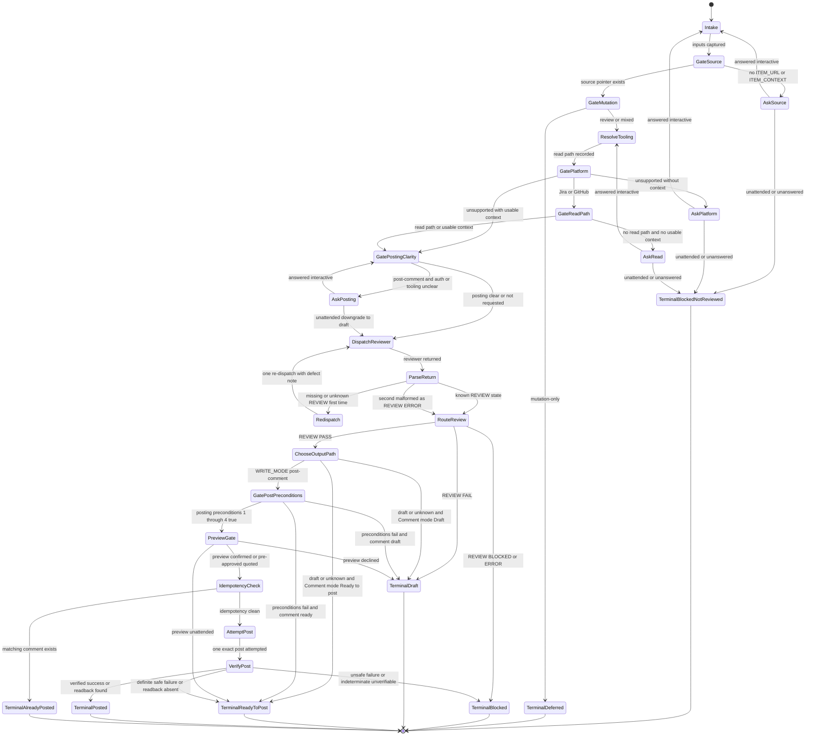

# Refine Task Flow Diagram

Finite-state execution model for `refine-task`. Companion transition table: [`state-machine.md`](./state-machine.md). Summary — normative text for definitions, gates, states, boundaries, and posting lives in [`./references/reviewer-policy.md`](./references/reviewer-policy.md).

## Invariants

- Every terminal reply explains the outcome and deferred actions in prose, includes the exact available comment under `Comment:`, and provides `Run notes:`. Public mode and status routing lines are omitted.
- The reviewer is dispatched once, plus at most one re-dispatch for a named malformed return.
- No path posts without explicit posting intent, confirmed write tooling, `REVIEW: PASS`, `POST_ALLOWED: yes`, preview or quoted pre-approval, and a clean idempotency check.
- The comment's `Refinement status:` verdict preserves the reviewer `REVIEW_STATUS` verbatim after dispatch. Before dispatch, explain that no review occurred and omit the comment.
